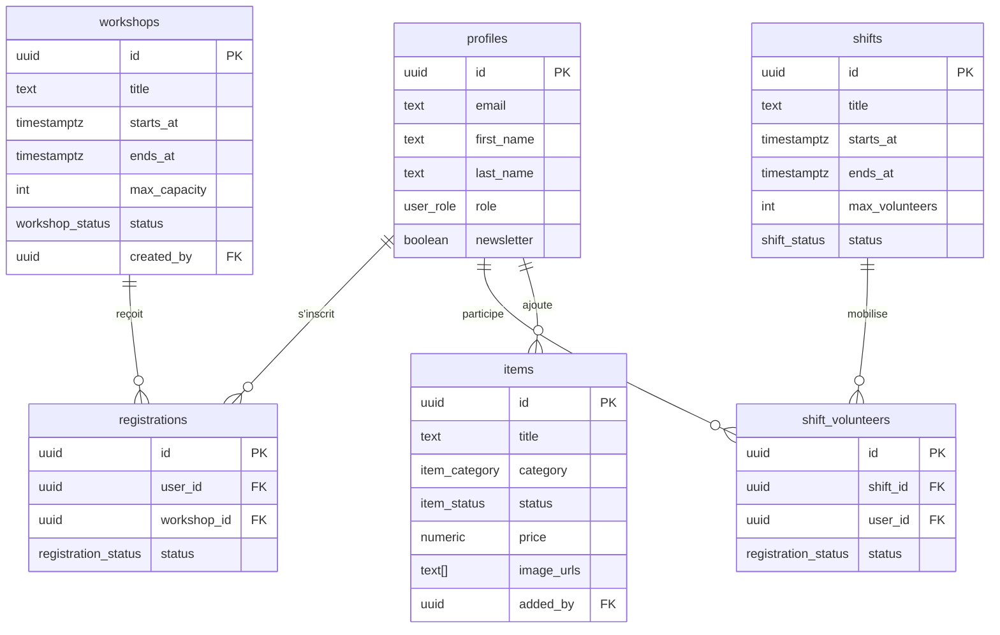

# Ressourcerie — Backend (Supabase)

## Stack choisie : Supabase (BaaS)

| Couche | Technologie |
|--------|-------------|
| Auth | Supabase Auth (JWT + RLS) |
| Base de données | PostgreSQL (via Supabase) |
| API | Auto-générée REST + Realtime |
| Fichiers | Supabase Storage |
| Fonctions serveur | Edge Functions (Deno) |

---

## Structure du projet backend

```
ressourcerie-back/
└── supabase/
    ├── schema.sql          ← Schéma complet DB + RLS
    ├── seed.sql            ← (à créer) Données de test
    └── functions/
        ├── send-email/     ← (à créer) Notification emails
        └── unsubscribe/    ← (à créer) Gestion désinscription newsletter
```

---

## Modèle de données



---

## Politiques RLS (Row Level Security)

| Table | Public | Membre/Bénévole | Admin |
|-------|--------|-----------------|-------|
| `profiles` | ❌ | Voir/modifier le sien | ✅ Tout |
| `items` | Voir `available` | Voir tout | ✅ CRUD |
| `workshops` | Voir tout | Voir tout | ✅ CRUD |
| `registrations` | ❌ | Voir/créer les siennes | ✅ Tout |
| `shifts` | ❌ | Voir tout | ✅ CRUD |
| `shift_volunteers` | ❌ | Voir/gérer les siennes | ✅ Tout |

---

## Setup Supabase (démarrage)

```bash
# 1. Installer Supabase CLI
npm install -g supabase

# 2. Initialiser le projet local
cd ressourcerie-back
supabase init

# 3. Lancer Supabase en local (Docker requis)
supabase start

# 4. Appliquer le schéma
supabase db push
# ou manuellement via l'éditeur SQL du Dashboard Supabase

# 5. Créer les buckets Storage
supabase storage create items-images
supabase storage create workshop-covers
```

---

## Variables d'environnement (côté front)

```env
VITE_SUPABASE_URL=https://xxxx.supabase.co
VITE_SUPABASE_ANON_KEY=eyJhbGciOiJI...
```

---

## Premier admin

Après inscription via l'interface :
```sql
UPDATE public.profiles 
SET role = 'admin' 
WHERE email = 'admin@ressourcerie.fr';
```

